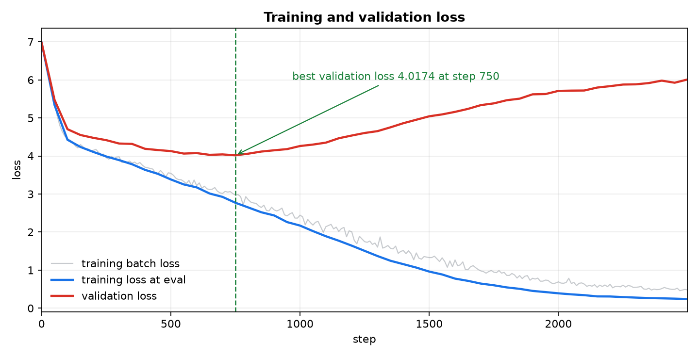
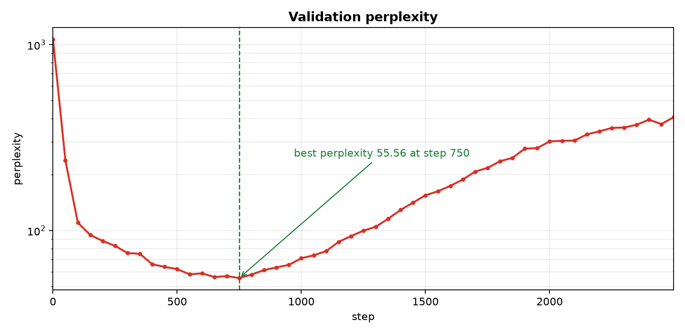
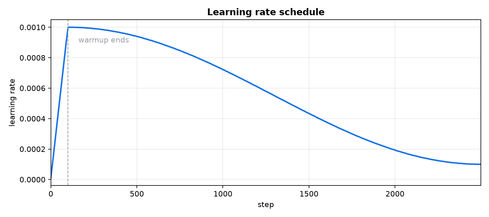
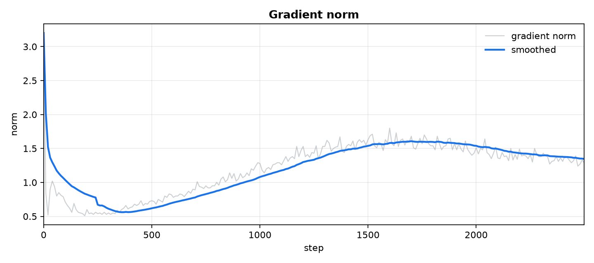
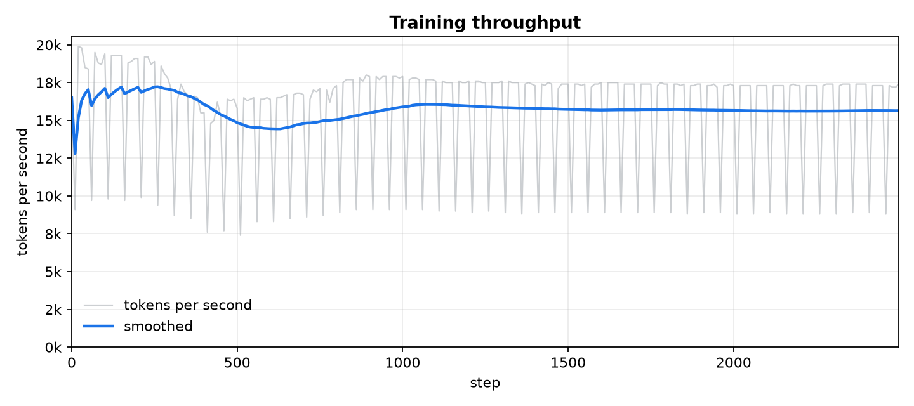

# gpt

A small GPT2 style language model implemented from scratch in PyTorch. Everything is in this repository: the byte level BPE tokenizer, the transformer, the training loop, and the sampling scripts. No pretrained weights, no tokenizer downloads, and no model frameworks beyond PyTorch and NumPy.

Training status: complete. The model finished all 2500 steps in about 24 minutes. Validation loss was lowest at step 750, so run/best.pt holds that checkpoint. The full log lives in TRAIN.md.

## Highlights

* 11,139,072 parameters in a 6 layer GPT2 style decoder
* byte level BPE tokenizer with a 1024 token vocabulary trained on the corpus
* best validation loss 4.0174, validation perplexity 55.56, at step 750
* trained on a MacBook Air M4 with 16 GB memory in about 24 minutes
* complete pipeline: prepare, train, sample, and publish to Hugging Face

## Quick start

Requires Python 3.11 or newer and uv.

```
uv sync
uv run python prepare.py
uv run python train.py
uv run python generate.py --prompt "ROMEO:"
```

prepare.py downloads Tiny Shakespeare, trains the tokenizer, and writes the train and validation files. train.py follows the default plan of 2500 steps.

## Model

* parameters: 11,139,072
* layers: 6
* attention heads: 6
* embedding width: 384
* context length: 256 tokens
* vocabulary: 1024 tokens
* activation: GELU with the tanh approximation
* normalization: LayerNorm before each attention block and each MLP block
* dropout: 0.1
* output head: tied to the token embeddings
* precision: float32

The architecture follows GPT2: learned position embeddings, causal self attention, MLP blocks with a 4x expansion, and a final LayerNorm before the language model head. Weight init uses a normal distribution with standard deviation 0.02, and the projection matrices in each residual branch use a smaller scale of 0.02 divided by the square root of twice the layer count.

Parameter breakdown:

* token embeddings: 393,216
* position embeddings: 98,304
* 6 transformer blocks: 10,646,784
* final LayerNorm: 768
* total: 11,139,072

The output head shares its weights with the token embeddings, so the unique parameter count is 11,139,072. A float32 checkpoint is about 46 MB.

## Data

* corpus: Tiny Shakespeare, public domain play text from Andrej Karpathy's char rnn repository
* size: 1,115,394 characters and bytes
* tokenizer: 768 merges and 1024 vocabulary entries
* tokens after tokenization: 443,727
* compression: 2.51 bytes per token
* train split: 399,354 tokens
* validation split: 44,373 tokens
* split rule: 90/10 by position

## Hardware

* machine: MacBook Air M4 with 16 GB unified memory
* system: macOS on arm64
* Python: 3.14
* PyTorch: 2.14.1
* NumPy: 2.5.4
* compute backend: MPS, Apple Metal
* memory use: well under 1 GB for the model, optimizer, and activations

## Training plan

* optimizer: AdamW with beta values 0.9 and 0.95
* learning rate: 0.001 with 100 step warmup and cosine decay to 10 percent of the peak
* weight decay: 0.1 on matrices only
* gradient clipping: norm 1.0
* batch: 32 sequences of 256 tokens, so 8192 tokens per step
* steps: 2500 completed, about 51 passes over the training data
* evaluation: every 50 steps over 20 batches per split
* sampling: at step 0 and at the final step, temperature 0.8 and top k 64
* checkpoints: best validation loss and last state
* seed: 1337

## Training time

Measured on the M4 Air for the complete run:

* total wall clock time: 1413 s, about 23.5 minutes
* pure training step time: 0.42 to 0.47 s per step
* throughput: about 17,000 to 19,500 tokens per second
* first step: 1 to 3 s while Metal kernels compile
* evaluation cost: about 4 to 5 s per eval, 51 evals in total
* average over the whole run: 0.565 s per step including evaluations and sampling

The run finished all 2500 steps and wrote best.pt at the lowest validation loss, last.pt at the final step, and the eval history to history.json.

## Loss curve

Validation loss reached its lowest value 4.0174 at step 750, then rose while training loss kept falling. This is overfitting: after about 15 passes the model starts to memorize the 399,354 token training split. run/best.pt holds the step 750 checkpoint.

Evaluation loss for every 50 steps:

```
 step   train     val
    0  6.9762  6.9726
   50  5.3354  5.4735
  100  4.4261  4.7035
  150  4.2366  4.5510
  200  4.1064  4.4764
  250  3.9861  4.4158
  300  3.8904  4.3265
  350  3.7822  4.3172
  400  3.6354  4.1879
  450  3.5299  4.1555
  500  3.3827  4.1277
  550  3.2522  4.0629
  600  3.1742  4.0752
  650  3.0133  4.0296
  700  2.9245  4.0407
  750  2.7700  4.0174
  800  2.6463  4.0603
  850  2.5210  4.1157
  900  2.4365  4.1489
  950  2.2620  4.1803
 1000  2.1707  4.2614
 1050  2.0256  4.2995
 1100  1.8903  4.3505
 1150  1.7721  4.4653
 1200  1.6428  4.5365
 1250  1.5062  4.6036
 1300  1.3698  4.6525
 1350  1.2460  4.7526
 1400  1.1566  4.8612
 1450  1.0668  4.9519
 1500  0.9616  5.0425
 1550  0.8860  5.0922
 1600  0.7766  5.1590
 1650  0.7177  5.2373
 1700  0.6459  5.3364
 1750  0.6021  5.3818
 1800  0.5461  5.4645
 1850  0.5083  5.5058
 1900  0.4538  5.6199
 1950  0.4231  5.6271
 2000  0.3904  5.7104
 2050  0.3633  5.7174
 2100  0.3419  5.7201
 2150  0.3095  5.7976
 2200  0.3073  5.8343
 2250  0.2913  5.8768
 2300  0.2779  5.8826
 2350  0.2657  5.9157
 2400  0.2585  5.9795
 2450  0.2506  5.9247
 2499  0.2399  6.0090
```

Best checkpoint: step 750 with training loss 2.7700, validation loss 4.0174, validation perplexity 55.56.

Final step: training loss 0.2399, validation loss 6.0090, validation perplexity 407.09.

For reference, a uniform guess over 1024 tokens gives loss ln(1024) = 6.93.

## Plots

The figures below come from the completed run. Regenerate them with `uv run python plots.py`.

Training and validation loss. The dashed line marks the best checkpoint.



Validation perplexity on a log scale. The same best checkpoint is marked.



Learning rate across the run: linear warmup for 100 steps, then cosine decay.



Gradient norm, with a 25 point rolling mean.



Throughput. The sharp dips are measurement windows that included an evaluation, not slower training.



## Samples

Untrained model at step 0:

```
see thatthinkIfeelifs repchloogood Is Is et

fore cessI thoumZmarlorWhy, she timothst oll, my see INGas I ...
```

Best checkpoint at step 750, temperature 0.8, top k 64, seed 7, 220 new tokens:

```
ROMEO: worthy father hath
That thrice which he spent to be made
To this barny bark dish revenge from the wife of hope,
Thereford thou hast not before thy joi'a mortal man.
But, Warwick, Clarence shall be the world;
Is it to him be at the Tower:
'Tis slight where he will, Taste he slain, which nothing more dyears
The night of those that he do it? Will it ty:
Henry Hold him honourable,
And marry Paris, sing me by Siam Paris;
And therefore he is not an Warwick messen?

PRINCE EDWARD:
A otunt a ma suitor
Either the benef and devil to him.

PRINCE EDWARD:
```

Best checkpoint, seed 11:

```
JULIET: this shall I cannot tell
ULIET:
At you my time to wife is to give my patience: say as much
I be admine own facess
Which love this present that soritor, I
For before the deeds the pursuity and o' the greater
Of what thought once to give yours.

MERCUTIO:
Nay, good doubt not a hand
Which, as day, beat is the greatest ta cop of body a ma bosk,
Three shall I do get my flull of dless,
But slecry 'Come on, to rarve you to your hands.

TYBALT:

KING RICHARD III:
```

The best checkpoint produces Shakespeare style dialogue with character names, line breaks, and mostly word shaped text. It still invents words and breaks grammar, and it is not a general purpose model. The final checkpoint has lower training loss but higher validation loss, so it likely repeats parts of the training data.

## Hugging Face upload

upload.py packages a checkpoint, the tokenizer, and the inference code, generates a model card, and pushes the result to the Hugging Face Hub.

Log in once:

```
uv run hf auth login
```

Upload a checkpoint:

```
uv run python upload.py --repo-id yourname/gpt_shakespeare
```

The default checkpoint is run/best.pt, the step 750 model with the lowest validation loss. To publish the final checkpoint instead, pass `--ckpt run/last.pt`.

Options:

* `--ckpt`: path to the checkpoint, default run/best.pt
* `--data-dir`: directory that contains tok.json, default data/shakespeare
* `--stage-dir`: local folder for the upload package, default run/hf
* `--repo-id`: full repository name, required
* `--private`: creates a private repository
* `--token`: access token, otherwise the saved login or HF_TOKEN is used
* `--dry-run`: builds the package without uploading
* `--planned-steps`: step count shown on the model card, default 2500

Uploaded files:

* best.pt
* tok.json
* config.py
* model.py
* tokenizer.py
* generate.py
* README.md, generated model card

The model card shows the parameter count, architecture, checkpoint step, validation loss, and usage commands. The repository is a custom implementation and not a transformers model, so it must be loaded with the included code and not with AutoModelForCausalLM.

## Files

* config.py: model and training settings, device selection
* tokenizer.py: byte level BPE tokenizer with fit, encode, decode, save, and load
* model.py: attention, MLP, transformer block, GPT model, and sampling
* dataset.py: memory mapped train and validation batches
* prepare.py: downloads the corpus, trains the tokenizer, writes token files
* train.py: training loop with warmup, cosine decay, evaluation, sampling, checkpoints, and resume
* generate.py: loads a checkpoint and samples text
* plots.py: builds the training plots in plots/
* upload.py: packages a checkpoint and publishes it to Hugging Face
* TRAIN.md: local training log, not tracked by git
* DECISIONS.md: local design notes, not tracked by git

## Limitations

* The model overfits after step 750. The best checkpoint produces Shakespeare style text with invented words and broken grammar, and the final checkpoint has much lower training loss but higher validation loss.
* The corpus is about 1.1 million characters, so the model can only learn the style of one small collection of plays.
* The validation split has 44,373 tokens, so validation loss moves by a few hundredths between evaluations.
* An interrupted run cannot resume unless last.pt was written at the end of an earlier run.
* The implementation favors clarity over speed. There is no torch.compile, mixed precision, or distributed training.
* Checkpoints are not part of the git repository. They are written to run/ and ignored, so a fresh clone needs its own training run.

## Credits

Data: Tiny Shakespeare from Andrej Karpathy's char rnn repository. The play text is public domain.
Architecture ideas follow GPT2 and the nanoGPT teaching project.
